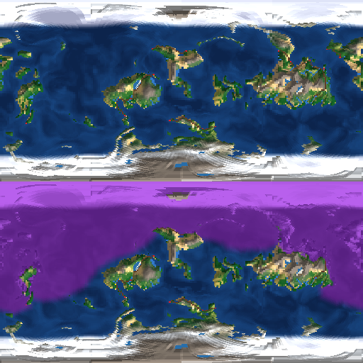

# Natural World V2.2 (Claude, 27/11/2026) : base expérimentale, pas encore branchée au rendu

Point de départ : la V2.1 de ChatGPT (`../natural-world-v21/world.mjs`, conservée telle quelle). La V2.2 garde son API (`worldSample(direction, seed)`, `audioInertia`) et ses clés de sortie, puis ajoute un monde « cuit » sur une cube-sphère où géologie, eau, climat, végétation et villes dépendent les uns des autres. Rien n'est branché à `index.html` : la V9.8.1 en ligne ne change pas.



Aperçu des **données** (pas le rendu du moteur), projection équirectangulaire. En haut : biomes, relief ombré, rivières (bleu vif), lacs, bassins fermés (blanc), routes (brun), ponts (jaune), villes (rouge). En bas : le front Dual Identity à 45 % (violet = identité B, couleur provisoire).

## Analyse de la V2.1 : ce que je garde
- Un module de données séparé du rendu, déterministe et testable dans Node.
- Des sorties continues : des poids de biomes qui se mélangent, jamais de frontière nette.
- Le masque d'identité pour Dual Identity.
- `audioInertia` (lissage exponentiel indépendant de la fréquence d'images), gardée à l'identique.

## Ce que je change, et pourquoi
| V2.1 | V2.2 | Raison |
|---|---|---|
| Humidité = bruit aléatoire | Humidité portée par les vents dominants depuis la mer (alizés, vents d'ouest, vents polaires) ; pluie quand l'air monte sur le relief ou se refroidit (capacité de l'air selon Clausius-Clapeyron) ; pluies équatoriales ; air descendant subtropical | Déserts, forêts et ombres pluviométriques aux bons endroits |
| Crêtes ajoutées partout | Ceintures de montagnes le long de limites de « plaques » (arcs insulaires en mer), crêtes multifractales, relief jeune ou aplani | Les montagnes forment des chaînes, comme sur Terre |
| Pas d'eau douce | Comblement des cuvettes (priority-flood), lacs, bassins fermés qui deviennent des déserts de sel quand l'évaporation dépasse les apports, rivières qui grossissent jusqu'à la mer | Hydrologie cohérente |
| Pas d'érosion | Érosion fluviale implicite (loi de puissance du courant) : plus il pleut, plus les vallées se creusent | Lien climat → géologie |
| Niveau de la mer fixe | Choisi pour une part de terres donnée (Terre : 29 %), en surface réelle des cellules | Même allure quelle que soit la graine |
| Température : latitude, altitude au-dessus de 0,5 | Latitude, 6,5 °C/km au-dessus de la mer, continentalité | Physique de base |
| 6 biomes ordonnés | 11 biomes du diagramme de Whittaker (température × précipitations, en °C et mm/an), poids continus ; banquise ; roche au-dessus de la limite des arbres | Végétation crédible |
| Pas de végétation chiffrée | Production végétale par le modèle de Miami | Densité des forêts et fertilité |
| Pas de civilisation | Aptitude (pente, eau, climat, fertilité, taille du continent), villes espacées, routes au moindre coût, ponts là où une route croise une rivière, ports, liaisons maritimes | Interactions climat, terrain et villes |
| Identité = demi-sphère bruitée | Front qui part d'un pôle déterministe, rapide sur la mer et les vallées, lent sur les montagnes ; valeur = part de surface déjà passée, donc `progress` 0 → 1 fait un morphing continu de toute la planète sans rien recalculer | Transition organique, frontières naturelles |
| Hash entier JS seul | Même hash en JS et en GLSL ES 3.0 (ci-dessous), octaves tournées | Même monde sur tous les appareils et entre données et rendu |
| Un objet par échantillon | Tableaux typés | Mémoire, ramasse-miettes |
| Pas de LOD | Chunks cube-sphère : sommets de bord identiques au bit près entre chunks, niveaux et faces (n puissance de 2), cibles de géomorphose | Ni couture ni saut de LOD |

## Mesures (Node, ce conteneur, un seul cœur)
Graine 7, N = 64 (24 576 cellules) : 0,5 s ; N = 32 : 0,2 s. Terres 26,7 % ; 135 cellules de rivière, 61 de lac, 25 de bassin fermé ; 43 terres dont 31 îles ; 16 villes (14 ports, 5 au bord d'une rivière), 10 routes, 5 ponts, 4 liaisons maritimes, 8 volcans. Surfaces : océan 68 %, glace 8,5 %, forêt tropicale 4,5 %, forêt tempérée 4,4 %, roche 4,1 %, désert 3 %, prairie 2,2 %, toundra 1,9 %, savane 1,8 %, taïga 1,6 %.
Vérifié : deux cuissons de la même graine sont identiques ; bords de chunks voisins et sommets parent/enfant identiques au bit près.

## Branchement prévu dans le moteur (Claude)
1. Worker : `bakeWorld({ seed, N: 64 })` au premier affichage d'une planète, cache borné (planète visée + 3 voisines). Version de générateur par planète : les planètes existantes gardent l'actuelle.
2. `packCubeMaps` : 2 cube maps RGBA8 de 6 × 64² (98 Ko chacune), envoyées telles quelles (format WebGL).
3. Shader : le relief fin reste calculé par pixel, guidé par les cube maps (climat, rivières, lacs, biomes, front d'identité via un uniform `progress`).
4. Rivières nettes de près : tracer les tronçons (cellule → aval) en champ de distance dans une cube map plus fine.
5. Villes : sites, routes, ponts et ports alimentent la croissance V9.8.

## Incompatibilités et limites notées
- Les tuiles V1.9 n'ont pas de climat tempéré (forêt tempérée, prairie, taïga, zones humides) : `v19Biome` renvoie `temperate` sans ressource. Mission proposée à ChatGPT.
- Le shader actuel utilise un bruit à sinus : passer au hash entier change l'aspect, donc seulement pour la nouvelle version de générateur.
- Les zones humides ne dominent encore nulle part (réglage à faire) ; les sédiments et deltas ne sont pas encore simulés.
- `worldSample` sans monde fourni cuit une version N = 32 et la garde en cache (cohérence avant vitesse).
- Musique : `audioEnvelope` (attaque rapide, retombée lente) module vagues, lumière et particules, jamais le terrain.

## Le même hash en GLSL ES 3.0
```glsl
float hash4(ivec3 c, int s){ uint h = uint(c.x) * 0x8da6b343u ^ uint(c.y) * 0xd8163841u ^ uint(c.z) * 0xcb1ab31fu ^ uint(s) * 0x165667b1u;
  h ^= h >> 16; h *= 0x7feb352du; h ^= h >> 15; h *= 0x846ca68bu; h ^= h >> 16; return float(h) * (1. / 4294967296.); }
```

## Essayer
`node assets/cosmic/natural-world-v22/demo.mjs 7 64 apercu.ppm` (graine, résolution, aperçu facultatif).

## Sources
Barnes, Lehman et Mulla 2014 (Priority-Flood) ; Braun et Willett 2013 (érosion implicite en O(n), base de FastScape) ; Whittaker 1975 (biomes) ; Lieth 1975 (modèle de Miami) ; circulation de Hadley, Ferrel et polaire.
